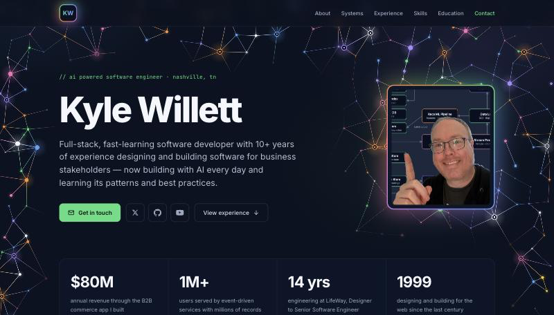

# Kyle Willett — Portfolio

Personal portfolio site for Kyle Willett: a single-page React app built with Vite and TypeScript. It's a static, dark-mode site — no backend, no routing, no data fetching — composed from a stack of section components.



## Tech stack

- **React 18** + **TypeScript** (strict)
- **Vite** for dev server and build
- Plain **CSS** in a single global stylesheet (`src/index.css`), themed with CSS custom properties — no CSS-in-JS or utility framework
- No linter or test suite; `npm run build` (type-check + build) is the gate

## Getting started

```bash
npm install      # install dependencies
npm run dev      # start the Vite dev server with HMR
```

Then open the URL Vite prints (defaults to http://localhost:5173).

## Scripts

```bash
npm run dev      # Vite dev server with HMR
npm run build    # Type-check (tsc -b) then build to dist/
npm run preview  # Serve the production build locally
```

`npm run build` type-checks with `tsc -b` before bundling and fails on type errors and on unused locals/parameters, so run it before considering a change done.

## Project structure

```
src/
  main.tsx          Entry point — mounts <App> in React StrictMode
  App.tsx           Composes the page by stacking section components in order
  index.css         The single global stylesheet (design tokens + all styles)
  components/        One component per section, plus shared pieces:
    Nav, Hero, About, Systems, Experience,
    Skills, Education, Contact, Footer,
    SectionHeading, Icons, NeuralNet, SocialLinks
  data/
    resume.ts       All page content (nav links, highlights, experience,
                    skills, systems-diagram data) as typed exports
index.html          Document shell: meta tags, Google Fonts, #root
```

### Editing content

Copy and data live in [`src/data/resume.ts`](src/data/resume.ts), not in the components — the components read from it. Edit text, highlights, experience, and skills there. Section order is controlled in [`src/App.tsx`](src/App.tsx), and section `id`s double as nav anchor targets (keep them in sync with `navLinks` in `resume.ts`).

## Notable pieces

- **Animated hero background** — [`NeuralNet.tsx`](src/components/NeuralNet.tsx) draws a node-and-edge "neural net" on a `<canvas>` behind the hero. It rebuilds on resize, pauses when offscreen, and renders a single static frame under `prefers-reduced-motion`.
- **Systems diagram** — the Systems section is a hand-built inline SVG of a fictional event-driven platform, rendered by [`Systems.tsx`](src/components/Systems.tsx) from the `arch*` exports in `resume.ts`.
- **Count-up highlights** — the stat numbers count up and drop into place on load, respecting `prefers-reduced-motion`.

## License

Private project — all rights reserved.
